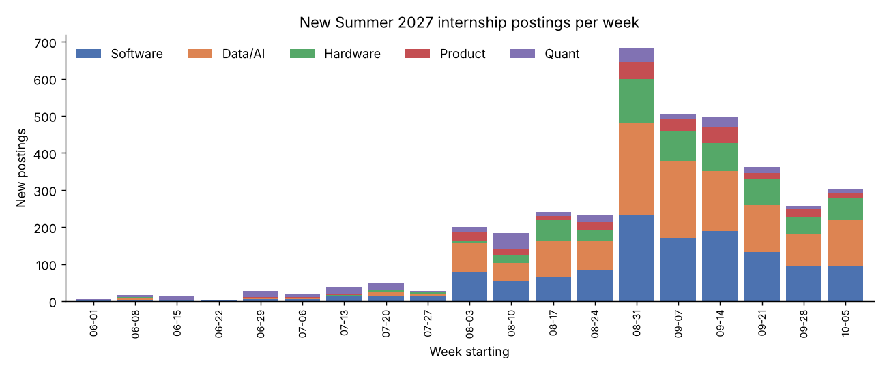
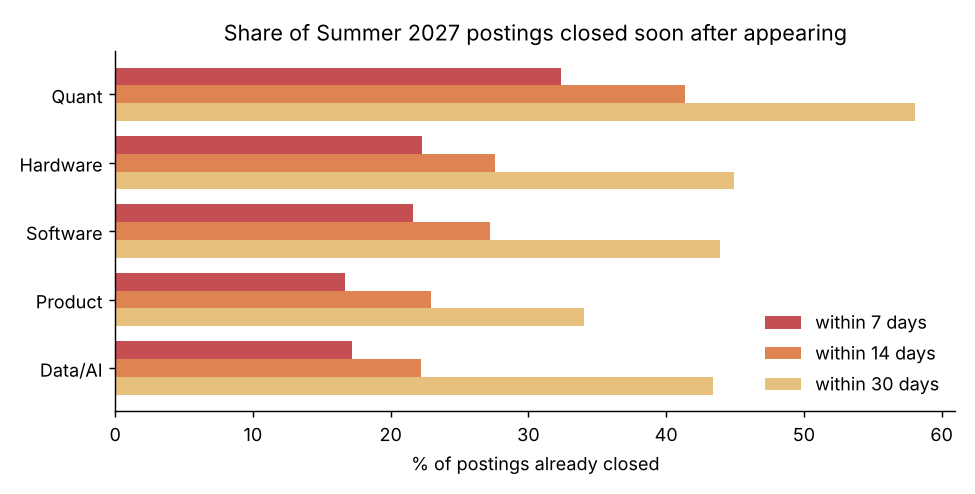
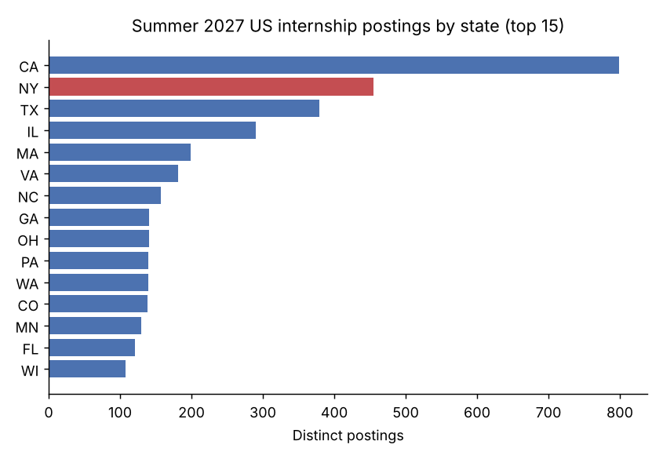
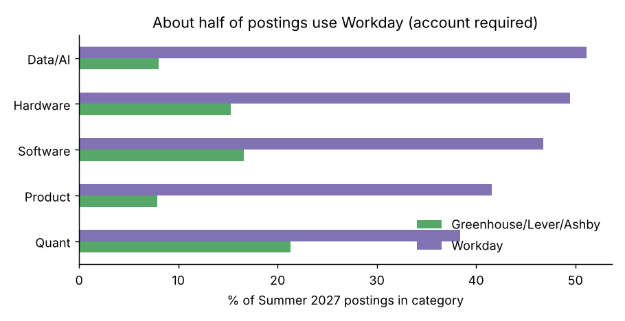

# The Summer 2027 Internship Market, in SQL

What does the Summer 2027 internship market look like, and what should a student do differently because of it? This project loads the full public [SimplifyJobs](https://github.com/SimplifyJobs/Summer2027-Internships) listings file into a normalized SQLite database and answers nine questions with plain SQL. It also rebuilds four months of git history to measure how fast postings close.

**Tools:** SQL (SQLite: CTEs, window functions, views, correlated subqueries), Python (pandas, matplotlib), git.

## Key findings (snapshot of Oct 12, 2026)

1. **Apply early.** Among Summer 2027 postings first seen Jun 18 to Sep 10, about **1 in 4 had closed within 14 days**, and the median posting stayed open about **30 days**. Quant roles close fastest: 41% within two weeks, median 21 days.
2. **The season peaks in early September.** The weeks of Aug 31 to Sep 14 brought **46%** of all Summer 2027 postings so far. The single biggest week was Aug 31 (684 new postings).
3. **New York is the #2 state.** It has **13.4%** of US Summer 2027 postings (455), behind California (23.5%). Most of those are in NYC (114 Data/AI, 104 Software and 99 Quant postings). Upstate New York has about 100.
4. **Roughly half of postings sit behind a Workday account.** Workday hosts **48%** of Summer 2027 postings. No-account systems (Greenhouse, Lever, Ashby) host only about 13%.
5. **Most roles are open to undergrads.** 80% of Data/AI postings list a Bachelor's degree or no degree requirement, as do 93% of Product and 94% of Software postings. Quant has the most graduate-only roles (27%).
6. **Sponsorship is rarely stated.** Only **0.6%** of postings carry an explicit sponsorship label, so international students have to read each posting.

| | |
|---|---|
|  |  |
|  |  |

## Data model

```
postings (id PK, company, title, category, active, date_posted, date_updated, sponsorship, ats, url)
  ├── posting_terms     (id FK, term)                       -- "Summer 2027", "Fall 2026", ...
  ├── posting_locations (id FK, location, state, country, is_remote)
  ├── posting_degrees   (id FK, degree)
  └── status_history    (id PK, first_seen, first_closed)   -- rebuilt from git history
VIEW s27 = postings with the term 'Summer 2027'
```

`build_db.py` cleans and loads the data. Along the way it merges old and new category labels, maps "NYC", "SF" and "LA" to states, flags remote roles and labels the ATS from the apply URL. Each question lives in its own file in `sql/`:

| File | Question | SQL techniques |
|---|---|---|
| `01_overview.sql` | Market size and share still open, by category | aggregation |
| `02_weekly_pace.sql` | New postings per week | date functions |
| `03_days_open.sql` | How fast postings close | CTEs, `ROW_NUMBER()` percentiles, cohort design |
| `04_locations.sql` | Postings by state | `COUNT(DISTINCT)`, scalar subquery |
| `05_ny_split.sql` | NYC vs. rest of NY vs. remote | `CASE` bucketing |
| `06_ats_mix.sql` | Which application systems employers use | window `SUM() OVER (PARTITION BY)` |
| `07_undergrad_access.sql` | Undergrad vs. graduate-only roles | `EXISTS` / `NOT EXISTS` |
| `08_analytics_employers_ny.sql` | Top analyst-role employers in NY or remote | dedup CTE, `GROUP_CONCAT` |
| `09_sponsorship_labels.sql` | How often sponsorship is stated | ratio to total |

## How the closing-speed metric works

The listings file only stores a posting's current state. To see when postings closed, `extract_history.py` walks the repo's git history and takes one snapshot of `listings.json` every 3 days from Jun 15 to Oct 10, 2026 (40 snapshots). It records the first snapshot where each posting appears and the first where it shows as closed. The cohort only includes postings first seen by Sep 10, so every posting has at least 30 days of follow-up. Postings still open on Oct 10 count as open, not dropped.

## Run it

```bash
pip install pandas matplotlib
python build_db.py       # -> output/internships.db
python run_analysis.py   # -> output/*.csv and output/chart_*.png
```

## Limitations

The data covers one community-maintained aggregator, not the whole market. Closing dates are accurate to about 3 days, and "closed" means the aggregator marked the posting inactive. Category, degree and sponsorship labels come from the source and are not hand-checked. State counts include multi-city postings once per state.
