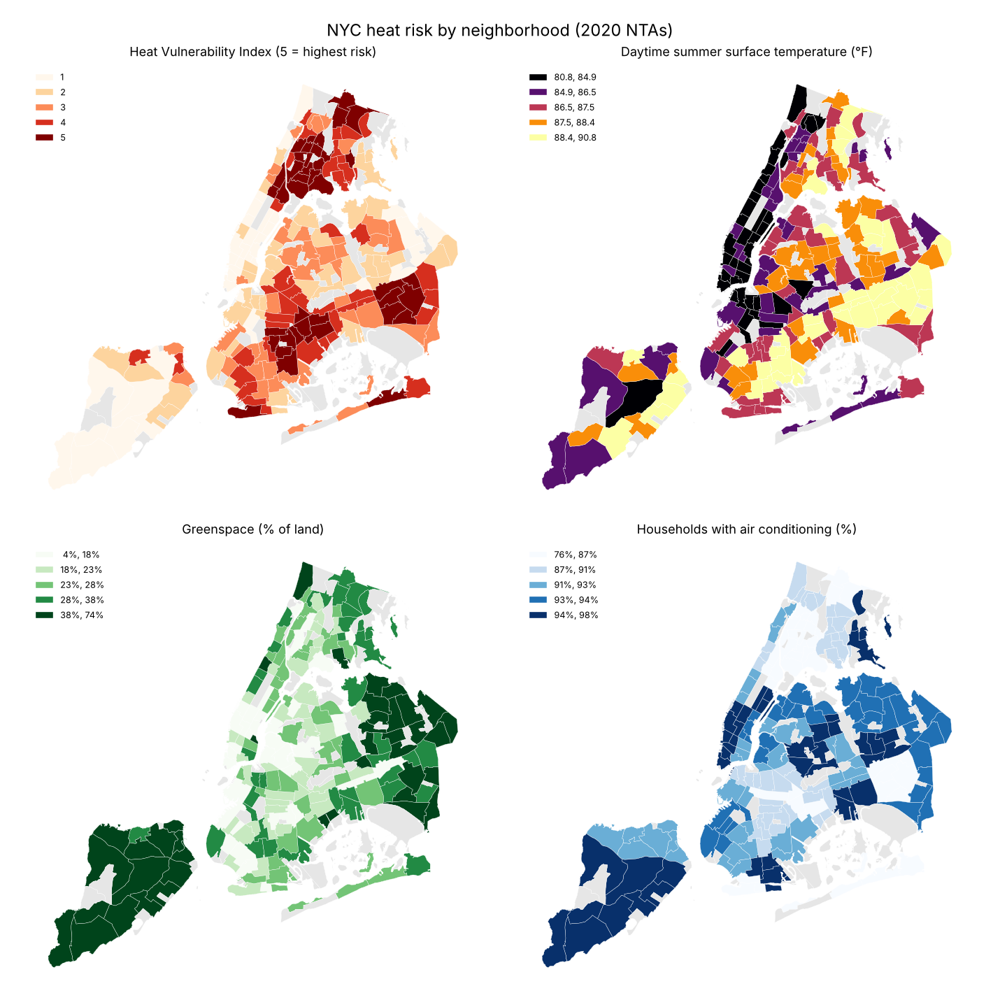
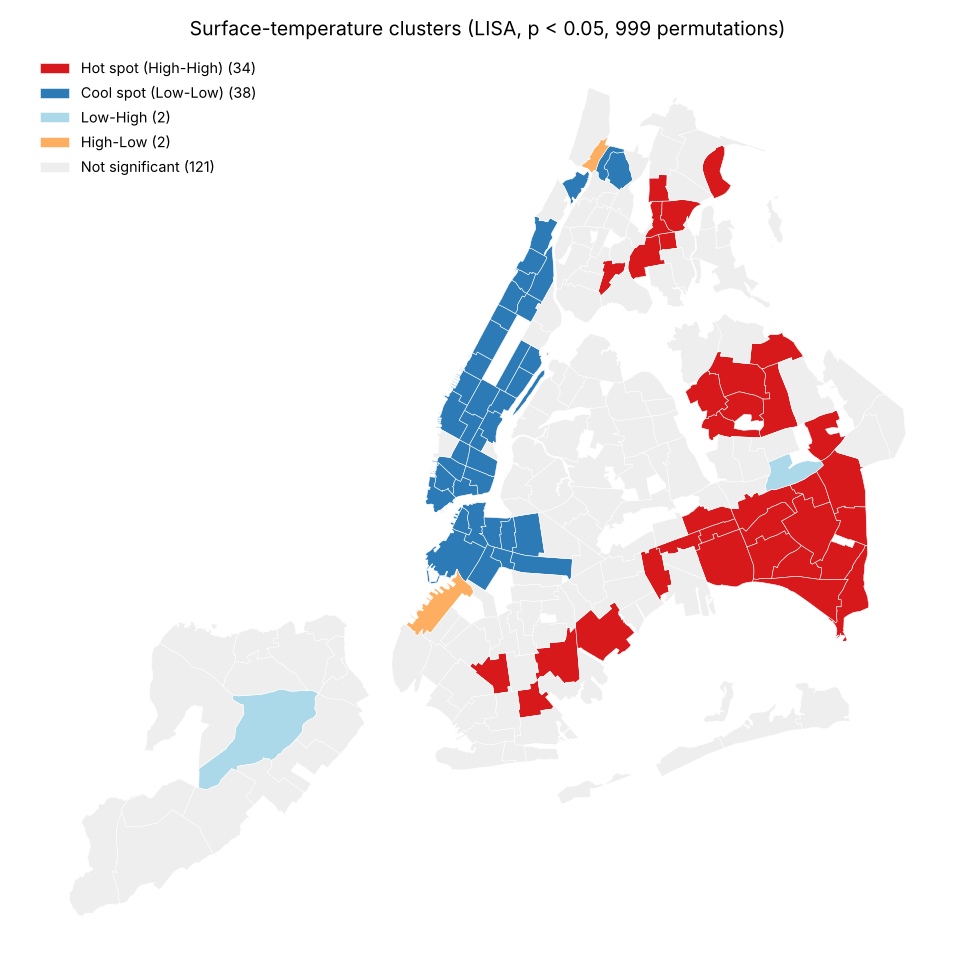
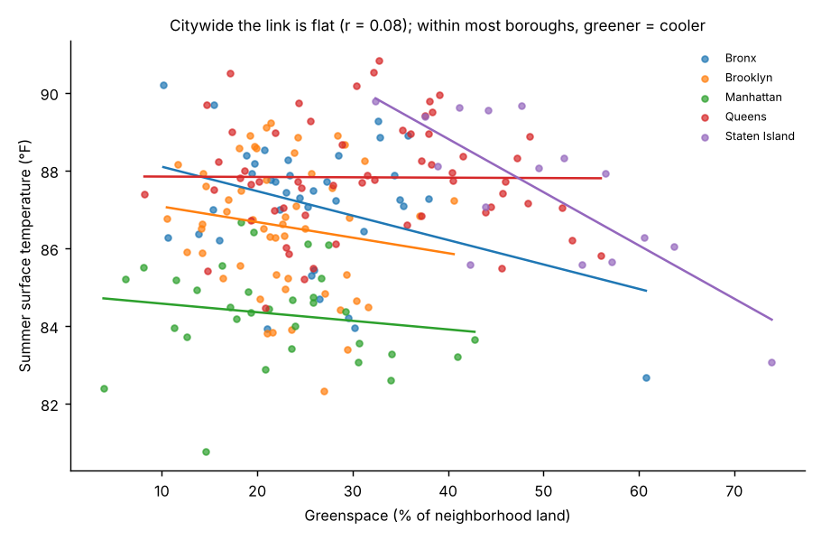

# Where Is Extreme Heat Most Dangerous in NYC? A Neighborhood GIS Analysis

Heat kills more New Yorkers than any other weather hazard. This project maps the city's Heat Vulnerability Index (HVI) across 197 residential neighborhoods (2020 NTAs). It then tests whether heat risk clusters in space and checks how much greenspace actually cools a neighborhood once borough and income are held constant.

**Tools:** Python, GeoPandas, PySAL (`libpysal`, `esda`, `spreg`), statsmodels, matplotlib. All analysis is in NY State Plane (EPSG:2263).

## Key findings

1. **Heat risk is strongly clustered.** Global Moran's I is 0.67 for the HVI and 0.60 for surface temperature (p = 0.001, 999 permutations), so high-risk neighborhoods sit next to other high-risk neighborhoods. Of the 40 neighborhoods with the top HVI score (5), 19 are in the Bronx and 11 in Brooklyn.
2. **The hottest surfaces are not where most people expect.** LISA finds 34 statistically significant surface-temperature hot spots: 22 in southeast and central Queens, 7 in the Bronx and 5 in Brooklyn. Manhattan forms a large cool cluster (38 cool spots in total).
3. **Greenspace cools, but only after controlling for confounders.** Citywide, greenspace and surface temperature are almost uncorrelated (r = 0.08), because green outer-borough areas are also low-rise and paved. Within each borough and holding income constant, each extra 10 percentage points of greenspace goes with a **0.29°F cooler** surface (OLS, 95% CI −0.53 to −0.06). The OLS residuals are still spatially clustered (Moran's I = 0.46). A spatial error model that accounts for this gives a stronger estimate: **−0.92°F per 10 points** (λ = 0.76).
4. **Heat risk and air pollution hit different places.** Fine-particle pollution (PM2.5) peaks in Midtown Manhattan, where HVI is lowest. Across neighborhoods the two measures are essentially unrelated (Spearman ρ = −0.06), so one "environmental burden" map would hide both problems.
5. **Priority neighborhoods.** The hottest HVI-5 neighborhoods combine high surface temperatures (89–90.5°F) with below-average air-conditioning access (84–90% vs. a citywide median of 92%). They include Hollis, Hunts Point, South Jamaica, St. Albans, Jamaica and Westchester Square (`output/priority_neighborhoods.csv`).



| | |
|---|---|
|  |  |

## Methods

1. **Join.** NTA 2020 polygons are joined to the HVI table by NTA code. All 197 HVI neighborhoods match a polygon (the source lists one neighborhood, BX0802, twice; the duplicate is dropped). The remaining 65 of the 262 polygons are parks, airports and cemeteries with no residents, shown in gray.
2. **Areal interpolation.** The air-quality data is published on the older 2010 NTA boundaries. Each 2020 neighborhood gets the area-weighted average PM2.5 and NO₂ of the 2010 polygons it overlaps (`geopandas.overlay`).
3. **Spatial weights.** Neighbors are defined by Queen contiguity (shared edge or corner) and the weights are row-standardized.
4. **Spatial autocorrelation.** Global Moran's I is computed for five variables, and Local Moran's I (LISA) maps significant hot and cool spots (p < 0.05).
5. **Regression.** Surface temperature is regressed on greenspace, log median income and borough fixed effects (OLS with HC1 robust errors), followed by a maximum-likelihood spatial error model because the OLS residuals were spatially autocorrelated.

## Run it

```bash
pip install geopandas libpysal esda spreg mapclassify statsmodels matplotlib
python analysis.py     # maps, tables, model summaries and results.json in output/
```

## Data

All data comes from the NYC Department of Health and Mental Hygiene's [Environment & Health Data Portal](https://github.com/nychealth/EHDP-data) (Apache-2.0): the Heat Vulnerability Index by 2020 NTA (`hvi-nta-2020.csv`), the Neighborhood Air Quality Explorer (`aqe-nta.csv`, NYC Community Air Survey annual averages) and NTA 2010/2020 boundaries (packed into `nyc_nta.gpkg`).

## Limitations

Surface temperature is land-surface temperature from satellite imagery, not air temperature. The analysis is cross-sectional and ecological (neighborhood averages), so it shows associations, not individual risk or causation. Areal interpolation assumes pollution is spread evenly within each 2010 polygon.
