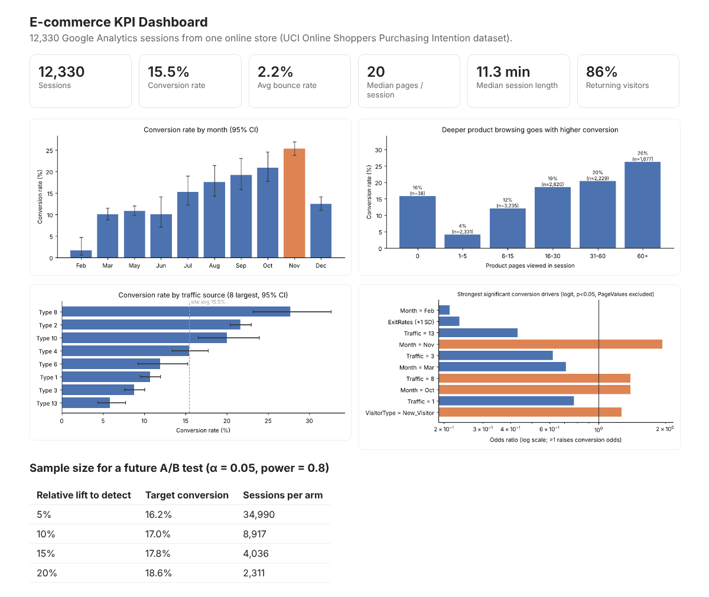
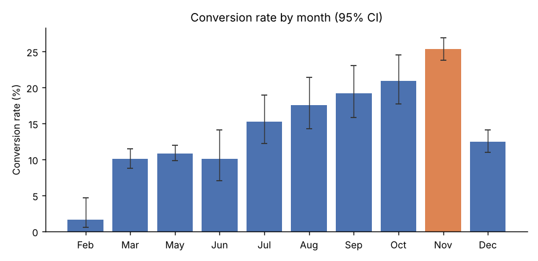
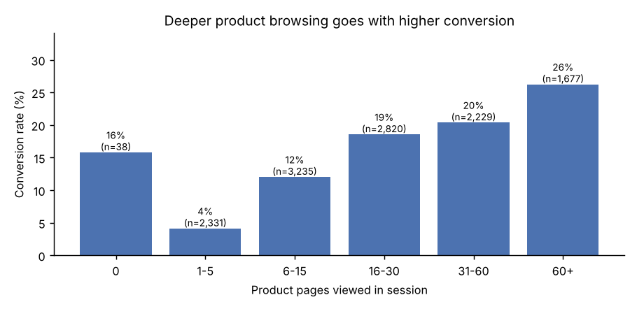
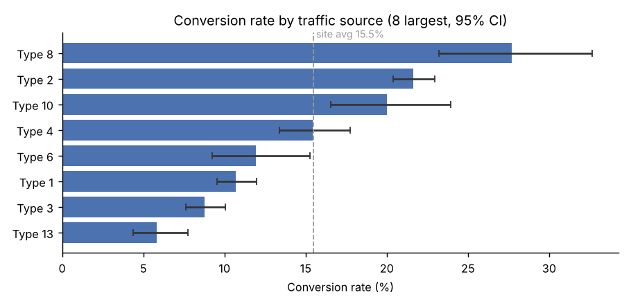
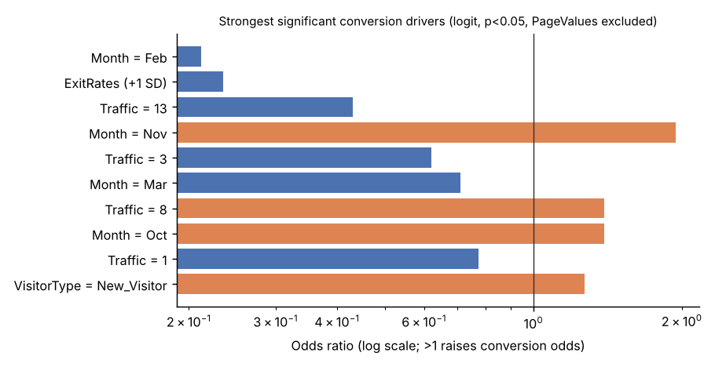

# E-commerce Web Analytics: KPIs, Conversion Drivers and Experiment Sizing

An online store wants to know what drives purchases and how to test improvements. This project analyzes 12,330 Google Analytics sessions from one store over a year. It builds a KPI dashboard, compares segments with proper confidence intervals and significance tests, models what predicts conversion, and sizes a future A/B test.

**Tools:** Python (pandas, SciPy, statsmodels, scikit-learn, matplotlib). The output is a one-file HTML dashboard (`output/dashboard.html`).



## Key findings

1. **Baseline.** 15.5% of sessions end in a purchase (95% CI 14.9% to 16.1%). The median session views 20 pages over 11.3 minutes, and 86% of sessions come from returning visitors.
2. **Seasonality dominates.** Conversion climbs from about 10% in spring to **25.4% in November**. November alone brings **40%** of the year's purchases. February converts at only 1.6%, and December falls back to 12.5%. After controlling for everything else in the model, November sessions have **1.9x** the odds of buying compared with May.
3. **New visitors convert better than returning ones.** New visitors convert at 24.9% vs. 13.9% for returning visitors (z = 11.6, p < 0.001), and the gap holds after controls (odds ratio 1.27). This is observational, so it could reflect who arrives as a new visitor (for example, from a product ad) rather than anything about being new.
4. **Traffic sources differ a lot.** Conversion ranges from 5.8% (traffic type 13) to 27.7% (type 8) among the eight largest sources (χ² = 335, p < 0.001). Budget should follow the high-converting sources.
5. **Exits signal lost sales.** Each +1 SD in exit rate cuts the odds of purchase by about 77% (odds ratio 0.23), the strongest behavioral signal in the model.
6. **Watch for leakage.** "Page Value" looks like a near-perfect predictor: 56% of sessions with Page Value > 0 convert vs. 3.9% without. But Google Analytics computes Page Value from pages that led to a transaction, so it partly encodes the outcome. A logistic model reaches a cross-validated AUC of 0.91 with it and **0.75 without it**. The interpretable model excludes it.
7. **A/B test sizing.** To detect a 10% relative lift in conversion (15.5% to 17.0%) at α = 0.05 and 80% power, a test needs **8,917 sessions per arm**. Detecting a 5% lift needs about 35,000 per arm (70,000 in total), roughly six times the 12,330 sessions in this dataset.

| | |
|---|---|
|  |  |
|  |  |

## Methods

- **KPIs and segments.** Conversion rates are reported with Wilson 95% confidence intervals. Segments are compared with two-proportion z-tests (new vs. returning, weekend vs. weekday) and a χ² test across traffic sources.
- **Engagement depth.** Conversion is broken out by how many product pages the session viewed: 1–5 pages convert at 4%, 60+ pages at 26%.
- **Driver model.** A statsmodels logistic regression with standardized numeric features and explicit reference groups (May, returning visitor, traffic type 2) gives interpretable odds ratios with p-values (`output/conversion_drivers_odds_ratios.csv`). A scikit-learn pipeline with 5-fold stratified cross-validation measures predictive AUC with and without Page Value.
- **Experiment design.** Sample sizes come from a power analysis for two proportions (`statsmodels` `NormalIndPower`).

## Run it

```bash
pip install pandas scipy statsmodels scikit-learn matplotlib
python analysis.py      # charts, CSV tables, model summaries, results.json, dashboard.html in output/
```

## Data

[Online Shoppers Purchasing Intention Dataset](https://archive.ics.uci.edu/dataset/468/online+shoppers+purchasing+intention+dataset), UCI Machine Learning Repository (Sakar, Polat, Katircioglu & Kastro, 2018; CC BY 4.0). Each row is one session with Google Analytics page-type counts and durations, bounce, exit and page-value metrics, month, visitor type, traffic source and whether it ended in revenue. The copy in `data/` was taken from a public GitHub mirror of the UCI file.

## Limitations

The data has no January or April sessions, and session counts per month are uneven (for example, May has 3,364 and February 184), so only rates are compared across months, not volumes. Traffic sources are anonymized numeric codes. All comparisons are observational. The A/B sizing is a planning tool, not a test that was run.
