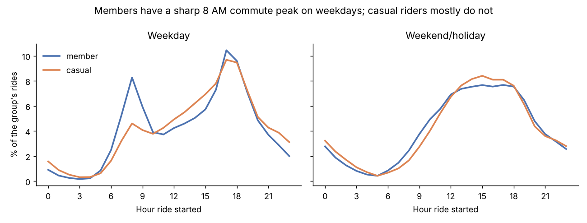
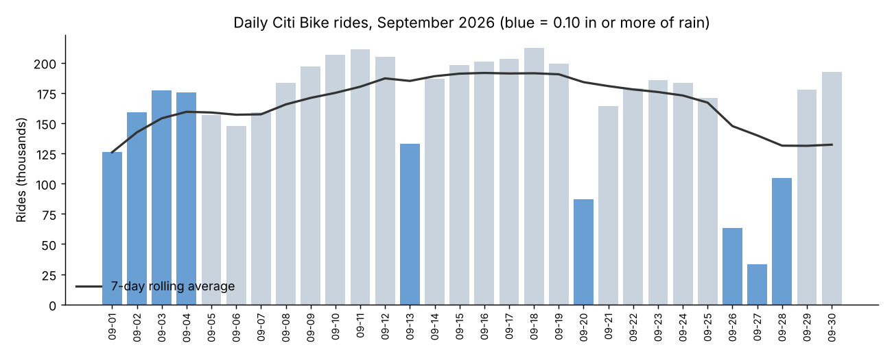
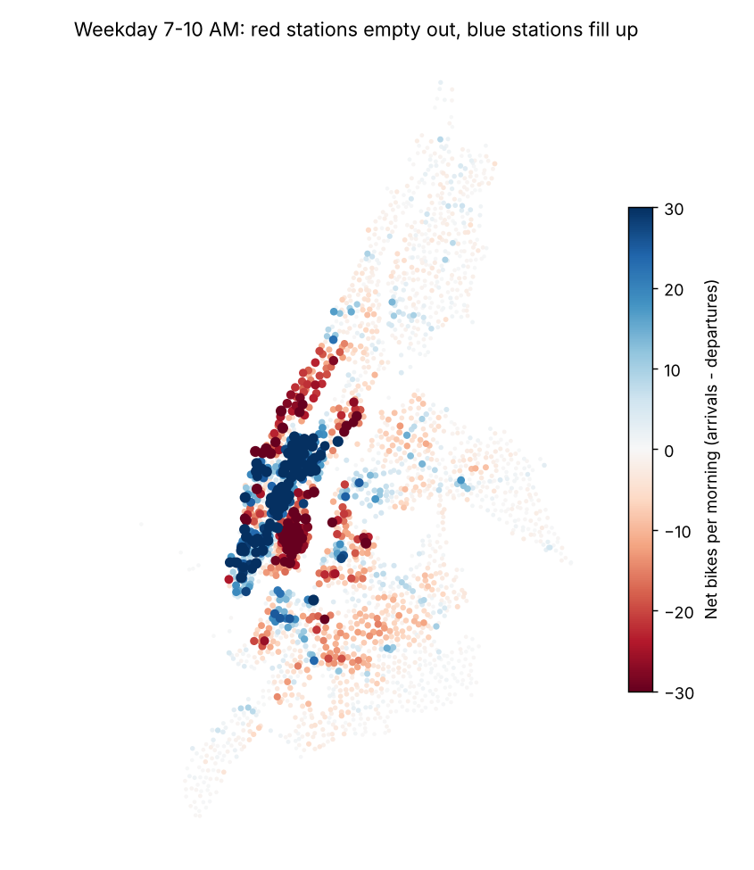
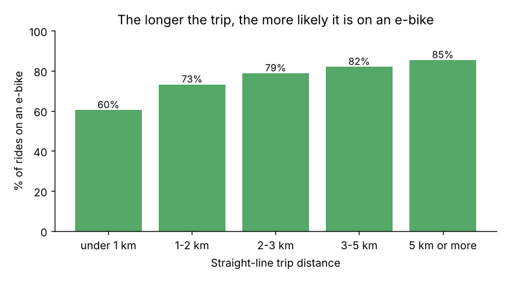

# NYC Citi Bike, in SQL: 5 Million Rides in September 2026

How do New Yorkers use Citi Bike, what does rain do to ridership, and where does the system run out of bikes every morning? This project loads every Citi Bike trip from September 2026 (about 5 million rows) into a SQLite star schema, joins it to NOAA daily weather for Central Park and answers nine questions with plain SQL.

**Tools:** SQL (SQLite: star schema, CTEs, window functions with frames, `LAG`, `RANK`, `EXISTS`, self-joins, SQL-based data cleaning), Python (pandas, matplotlib).

## Key findings

1. **Members are the core business.** Members took **81%** of the 4.98 million rides, and **73%** of all rides were on e-bikes. Members ride short: the median member ride was about **9 minutes**, against 12 to 15 minutes for casual riders.
2. **Members commute and casual riders do not.** On weekdays **19.5%** of member rides start between 7 and 10 AM, against **11.9%** of casual rides. Both groups peak at 5 to 6 PM. On weekends both curves flatten into one afternoon hump.
3. **Rain cuts ridership, and casual riders more.** On the storm weekend of Sep 26 to 27 (1.0 and 1.6 in of rain) member rides fell **62% to 72%** below dry days on the same weekday, and casual rides fell **78% to 90%**. Light weekday rain (0.1 to 0.3 in) cost about **11% to 17%** of member rides. Casual riders dropped more than members on 7 of the 9 wet days.
4. **Every weekday morning, bikes flow from homes to offices.** Residential stations in the East Village (Avenues A, B and C) and far-west Hell's Kitchen lose **50 to 71 bikes** each between 7 and 10 AM. Office stations around Grand Central, Flatiron, Hudson Square and Penn Station gain up to **135** (9 Ave & W 33 St). This is the imbalance Citi Bike's rebalancing vans have to fix.
5. **E-bikes win longer trips.** E-bikes carry **60%** of trips under 1 km and **85%** of trips over 5 km.
6. **Casual riders are tourists and park riders.** The stations with the highest casual share ring Central Park (up to **56%** casual at Central Park S & 6 Ave) and the Brooklyn Bridge in DUMBO. Every one of the top 10 casual weekend routes is a round trip, at Central Park, Governors Island or Roosevelt Island. Top member routes are short hops inside Williamsburg and Long Island City.

| | |
|---|---|
|  |  |
|  |  |

## Data model

```
trips (fact, one row per ride)                     stations (dimension)
  ride_id PK, rideable_type, member_casual,   ┌──>   station_id PK, name, lat, lng,
  started_at, ended_at, start_date,           │      kind ('NYC' / 'NJ' / 'system')
  start_hour, duration_min, distance_km,      │
  start_station_id FK ────────────────────────┤    weather_daily (dimension)
  end_station_id   FK ────────────────────────┘      date PK, tmax_f, tmin_f, precip_in, wind_mph
  start_date ─────────────── joins to ──────────>
VIEW rides = trips that look like real customer rides (1 min to 3 h, September, no repair-shop trips)
```

`build_db.py` only stages the raw CSVs as text tables. All cleaning happens in SQL in `sql/00_schema.sql`: fixing station IDs, building the station dimension, pivoting NOAA's long format into one row per day and computing the haversine distance of each ride. Each question lives in its own file:

| File | Question | SQL techniques |
|---|---|---|
| `01_data_quality.sql` | How clean is the raw data, and what does the analysis keep? | `UNION ALL` report, subqueries |
| `02_overview.sql` | Who rides, on what bike, and for how long? | `ROW_NUMBER()` median, window `COUNT() OVER` |
| `03_hourly_pattern.sql` | When in the day do members and casual riders ride? | `CASE` labels, `SUM() OVER (PARTITION BY)` share |
| `04_daily_trend.sql` | Daily rides with a 7-day rolling average, next to the weather | window frame `ROWS BETWEEN 6 PRECEDING`, `LAG()`, `LEFT JOIN` |
| `05_rain_effect.sql` | How much does rain cut rides, by rider type? | fact-to-dimension join, same-weekday baseline CTE |
| `06_station_imbalance.sql` | Which stations empty out or fill up in the morning rush? | `UNION ALL` unpivot, `RANK()` both directions, `CROSS JOIN` |
| `07_top_routes.sql` | Top routes for weekday members vs. weekend casual riders | `ROW_NUMBER()` top-N per group, joining one dimension twice |
| `08_ebike_by_distance.sql` | Do riders pick e-bikes for longer trips? | `CASE` bucketing, `SUM(COUNT(*)) OVER ()` |
| `09_casual_hotspots.sql` | Where do casual riders start? | `GROUP BY` / `HAVING` |

## Data cleaning worth knowing about

- **Split stations.** 68 stations appeared under two IDs because some rows lost a trailing zero (`5980.1` vs. `5980.10`), and four IDs had a stray underscore. Before the fix, "E 17 St & Broadway" looked like two stations, one with 15,000 departures and one with 0 departures and 10,000 arrivals, which put it second on the "fills up" list by mistake. `00_schema.sql` normalizes the IDs before anything else runs.
- **Bad coordinates.** About 2,600 e-bike trips with no start station carry placeholder coordinates thousands of kilometers away. Distances are only computed when both ends are inside the NYC area.
- **Not real rides.** 4,921 trips longer than 3 hours (mostly lost or mis-docked bikes), 549 trips that started on Aug 31 and 893 trips to or from a repair shop are excluded through the `rides` view. Together that is under 0.2% of the file.

## Run it

```bash
pip install pandas matplotlib
python build_db.py       # downloads the ~1 GB trip file, builds output/citibike.db (~5 min)
python run_analysis.py   # -> output/*.csv and output/chart_*.png
```

## Data sources

- Trips: [Citi Bike System Data](https://citibikenyc.com/system-data), file `202609-citibike-tripdata.zip`, used under the Citi Bike Data License Agreement.
- Weather: NOAA [GHCN-Daily](https://www.ncei.noaa.gov/products/land-based-station/global-historical-climatology-network-daily), station USW00094728 (Central Park), from the public AWS bucket `noaa-ghcn-pds`. The filtered file for Aug to Oct 2026 is in `data/`.

## Limitations

This is one month, so it says nothing about seasons. Weather is a daily total from one gauge, which cannot tell a rainy morning from a rainy night. For example Sep 13 had nearly 1 in of rain but member rides barely dropped, likely because the rain fell outside riding hours. Weekend baselines rest on only one to three dry days, and the wet weekdays cluster in the first week of the month, when ridership was still ramping up after Labor Day, so the rain percentages are rough. Distance is straight-line, not the route actually ridden. Net flow counts only customer trips, not the bikes Citi Bike moves by van.
