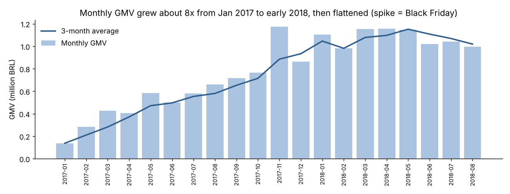
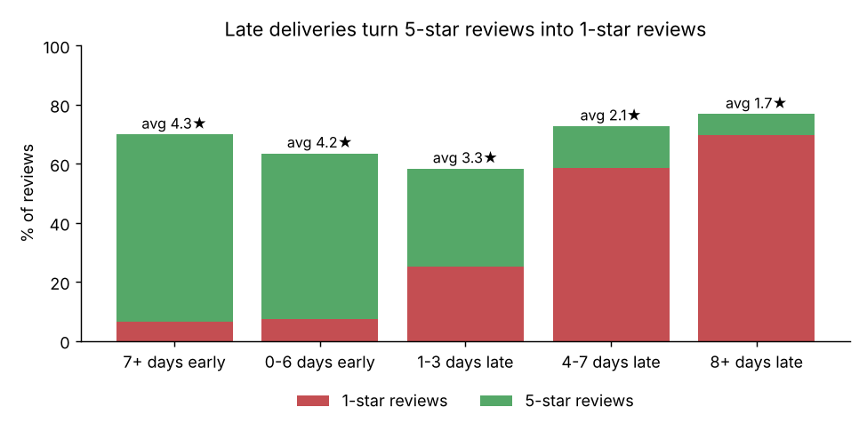
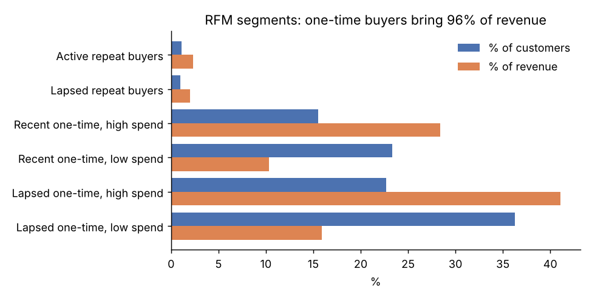
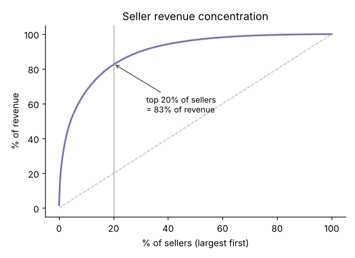

# E-commerce Customer Retention, in SQL: 100k Olist Marketplace Orders

Do customers of a big online marketplace come back, and what makes them unhappy? This project loads the public Olist dataset (about 99,000 orders placed in Brazil from 2016 to 2018, across 7 related tables) into SQLite and answers ten business questions with plain SQL: monthly KPIs, repeat-purchase rate, cohort retention, RFM segmentation, delivery performance, review scores and seller concentration.

**Tools:** SQL (SQLite: multi-table joins, CTEs, window functions `LAG` / `NTILE` / `RANK` / running `SUM`, cohort analysis, conditional aggregation), Python (pandas, matplotlib).

## Key findings (complete months Jan 2017 to Aug 2018)

1. **Almost nobody comes back.** Of 94,703 customers, only **2.2%** placed a second order on a later day. No monthly cohort kept even 1% of its customers in any later month. Customer IDs make this easy to get wrong: Olist issues a new `customer_id` for every order, so retention has to be measured on `customer_unique_id`. Same-day split checkouts also have to be excluded (821 people), or the repeat rate looks like 3%.
2. **Late delivery is the main cause of bad reviews.** Orders that arrived a week or more early averaged **4.3 stars**, and only 6.5% of them got 1 star. Orders 8 or more days late averaged **1.7 stars**, and **70%** of them got 1 star. Only 6.8% of orders were late, because Olist pads its delivery promise: 79% of orders arrived a week or more early.
3. **A late first order means fewer return customers.** Among customers whose first order was late, **2.0%** came back. Among those whose first order was on time, **2.9%** did, about 1.5 times as many. First orders rated 1 to 2 stars brought back 2.2% of customers, against 3.0% for 4 to 5 stars.
4. **The north and northeast wait longest.** The median delivery took **7 days in São Paulo** and **17 to 21 days** in Bahia, Ceará, Maranhão and Pará. Maranhão had the most late orders (17.5%), and Rio de Janeiro had 12% late despite a 12-day median.
5. **Growth stalled in 2018.** Monthly revenue (GMV) grew about **8x** from Jan 2017 to early 2018, then held flat at about R$1.0 to 1.15M a month. Black Friday (Nov 24, 2017) had **1,166 orders** in one day, about 5 times a normal November day.
6. **A few sellers carry the marketplace.** The top **1%** of sellers (31) brought in **26%** of item revenue, and the top **20%** brought in **83%**. Health & beauty, watches & gifts and bed & bath are the top three categories by revenue. Office furniture had the lowest rating among the top 15 categories (3.6 stars).

| | |
|---|---|
|  |  |
|  |  |

**So what?** For this marketplace, getting new customers matters more than keeping them, at least for now. The cheapest lever on reviews, and probably on repeat purchases, is delivery speed to the north and northeast. The data shows a link, not proof that late delivery causes people to leave. An A/B test on delivery promises or shipping subsidies by region would be the next step.

## Data model

```
customers (customer_id PK, customer_unique_id, zip_prefix, city, state)
    └── orders (order_id PK, customer_id FK, status, purchased_at, approved_at,
                shipped_at, delivered_at, estimated_delivery)
          ├── order_items (order_id FK, order_item_id, product_id FK, seller_id FK, price, freight)
          │      ├── products (product_id PK, category [English], weight_g, photos_qty)
          │      └── sellers  (seller_id PK, zip_prefix, city, state)
          ├── payments (order_id FK, sequence, type, installments, value)
          └── reviews  (order_id PK/FK, review_id, score, has_comment, created_at)
VIEW order_facts = one row per order: person, state, GMV, delivery days, late flag, review score
VIEW sales       = order_facts without canceled/unavailable orders, Jan 2017 to Aug 2018
```

`build_db.py` downloads the CSVs and stages them as text. `sql/00_schema.sql` does the typing and cleaning in SQL: it translates Portuguese category names, deduplicates about 550 orders that had more than one review (keeping the latest) and builds the two views. Each question has its own file:

| File | Question | SQL techniques |
|---|---|---|
| `01_data_quality.sql` | What is in the data, and what does the analysis keep? | `UNION ALL` report, `NOT EXISTS` |
| `02_monthly_kpis.sql` | Monthly orders, GMV, AOV and growth | `LAG()`, named `WINDOW`, rolling frame |
| `03_repeat_customers.sql` | How many customers ever come back, and how fast? | `ROW_NUMBER()`, self-join on later dates, median |
| `04_cohort_retention.sql` | Monthly cohort retention at 1, 2, 3, 6 and 12 months | cohort CTEs, month arithmetic, pivot with conditional aggregation |
| `05_late_delivery_reviews.sql` | How does lateness change review scores? | date math, `CASE` buckets, `SUM(COUNT(*)) OVER ()` |
| `06_delivery_by_state.sql` | Which states wait longest? | per-group median with `ROW_NUMBER()`, `HAVING` |
| `07_category_performance.sql` | Top categories by revenue and rating | multi-table joins, `RANK()`, running cumulative share |
| `08_seller_concentration.sql` | How concentrated is revenue among sellers? | `NTILE(100)`, `CROSS JOIN` thresholds |
| `09_rfm_segments.sql` | RFM customer segments | `NTILE(5)` scoring, `CASE` segmentation |
| `10_first_experience.sql` | Does a bad first order reduce return rates? | first-order CTE, correlated `EXISTS` |

## Definitions worth knowing

- **Customer** = `customer_unique_id`. `customer_id` is per order and would make every customer look new.
- **Repeat purchase** = an order on a later calendar day than the person's first order.
- **GMV** = item price plus freight from `order_items`. The payments table is not used for revenue because vouchers make about 300 orders' payments differ from their items.
- **Late** = delivered after the estimated delivery date shown at checkout.

## Run it

```bash
pip install pandas matplotlib
python build_db.py       # downloads ~64 MB of CSVs, builds output/olist.db (~10 s)
python run_analysis.py   # -> output/*.csv and output/chart_*.png
```

## Data source

[Olist work-at-olist-data](https://github.com/olist/work-at-olist-data) (MIT License), the same dataset Olist published on Kaggle as "Brazilian E-Commerce Public Dataset by Olist". Customer, seller and product identifiers are anonymized hashes.

## Limitations

This is a sample Olist released for analysis, not its full order book, so absolute revenue is not Olist's real revenue, though the ratios should still hold. Orders run only to Aug 2018, so recent cohorts had little time to return. The link between late delivery and repeat purchases is a correlation: late orders cluster in distant states, where buying habits may differ for other reasons. Revenue is in Brazilian reais and not adjusted for inflation.
