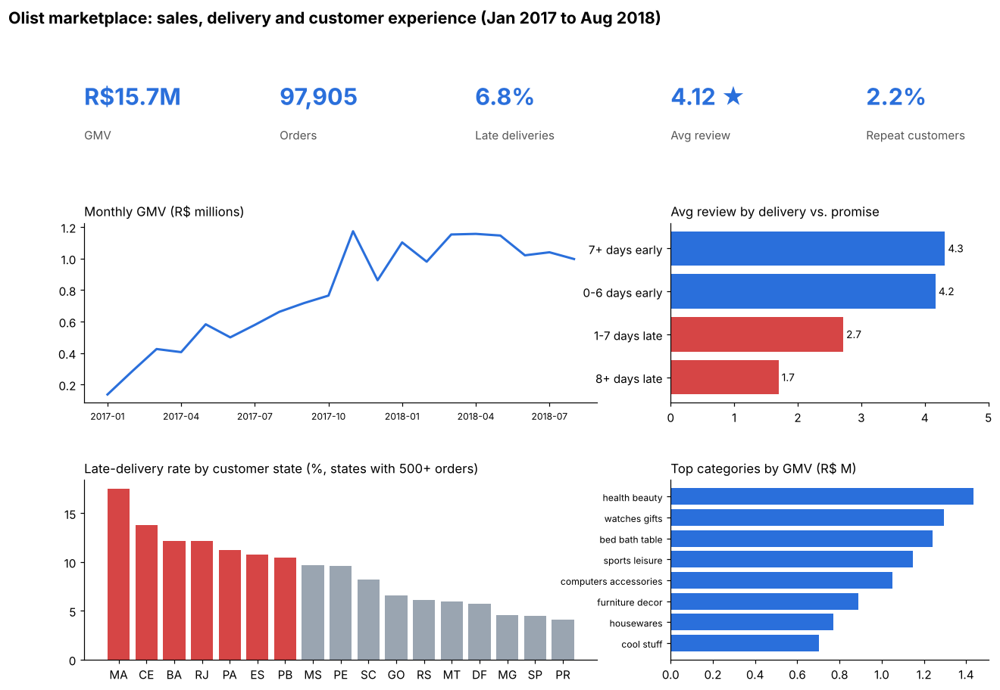

# Olist Marketplace Dashboard, in Tableau

An interactive dashboard for a marketplace operations manager. It answers three questions on one screen: **how are sales trending, where are deliveries late, and how much do late deliveries hurt reviews and repeat purchases?** It is built on the Olist data modeled in SQL in [project 06](../06-olist-ecommerce-sql/), so every number can be checked against that project.

**Tools:** Tableau Public (KPIs, calculated fields, LOD expressions, parameters, dashboard actions), SQL (SQLite) and pandas for the extracts.

> **Status:** the data extracts and a Python prototype of the layout are done. The Tableau Public version is being built from the guide below. <!-- TODO: replace this line with the Tableau Public link and a screenshot -->



*Python prototype (`prototype.py`) of the layout. The Tableau version adds filters, tooltips and click-to-filter.*

## What the dashboard shows (Jan 2017 to Aug 2018)

- **R$15.7M GMV across 97,905 orders**, growing about 8x through 2017 and then flat in 2018.
- **6.8% of delivered orders arrived late**, but late orders get much worse reviews: 4.3 stars when a week or more early vs. **1.7 stars** when 8+ days late.
- **The north and northeast wait longest.** Among states with 500+ orders, Maranhão (17.5%) and Ceará (13.8%) have the highest late rates, and São Paulo has one of the lowest.
- **Only 2.2% of customers ever order again**, so the first delivery experience matters a lot.

## Data

`export_extracts.py` builds two tidy CSVs from project 06's database. Hashed ids are replaced with short integer keys.

| File | Grain | Key fields |
|---|---|---|
| `data/orders.csv` | one row per order (97,905) | `order_date`, `customer_state`, `main_category`, `gmv`, `days_to_deliver`, `days_vs_promise`, `is_late`, `lateness_bucket`, `review_score`, `is_first_order`, `customer_returned` |
| `data/sellers.csv` | one row per seller (3,029) | `seller_state`, `orders`, `item_revenue`, `avg_review`, `late_rate` |

The export prints sanity checks that match project 06: 94,703 customers, a 2.2% repeat rate and a 6.8% late rate.

## Build it in Tableau Public

1. **Connect:** Tableau Public → *Text file* → `data/orders.csv`. Set `order_date` to Date, and `is_late`, `review_score`, `is_first_order` and `customer_returned` to Number (whole).
2. **Calculated fields**
   - `GMV` = `SUM([gmv])`
   - `Late rate` = `AVG([is_late])` (formatted as a percentage)
   - `Avg review` = `AVG([review_score])`
   - `Repeat rate` = `SUM(IF [is_first_order] = 1 THEN [customer_returned] END) / SUM([is_first_order])`
   - `Orders per customer (LOD)` = `{ FIXED [customer_key] : COUNTD([order_key]) }`
3. **Sheets**
   - *KPI tiles*: one text sheet each for GMV, orders (`CNTD(order_key)`), late rate, average review and repeat rate.
   - *Monthly GMV*: `MONTH(order_date)` on Columns, `GMV` on Rows, as a line chart.
   - *Reviews by lateness*: `lateness_bucket` on Rows, `Avg review` on Columns, colored red for the late buckets. Exclude "Not delivered".
   - *Late rate by state*: a filled map of Brazil using `customer_state` (set its geographic role to *State/Province*, country Brazil), colored by `Late rate`.
   - *Top categories*: `main_category` by `GMV`, filtered to the top 10.
4. **Parameter:** add a *Metric* parameter (GMV / Orders / Late rate) and a calculated field that switches the map's color between them.
5. **Dashboard:** use 1200 × 800 with the KPIs across the top and the four charts in a 2 × 2 grid, matching the prototype. Add a `purchase_month` range filter, and set the map as a **filter action** so that clicking a state filters every other sheet.
6. **Publish** to Tableau Public, then put the link and a screenshot at the top of this README and in the portfolio front page.

## Run it

```bash
python ../06-olist-ecommerce-sql/build_db.py   # once: downloads the data, builds olist.db
python export_extracts.py                      # -> data/orders.csv, data/sellers.csv
python prototype.py                            # -> output/prototype.png
```

## Limitations

- A multi-item order is assigned the category of its most expensive item, so category GMV is approximate.
- "Late" compares the delivery date with the date promised at checkout, as in project 06. Olist pads that promise, so the late rate understates slow deliveries.
- The data ends in August 2018 and comes from one Brazilian marketplace.
