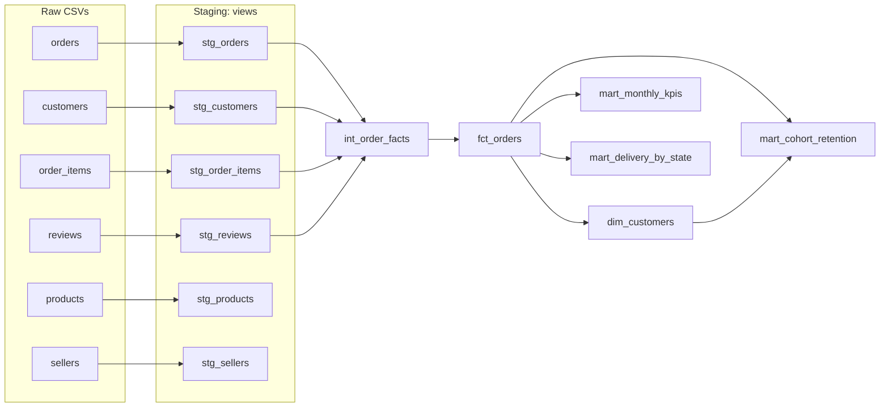

# Olist Marketplace, in dbt

Project 06 answered business questions about the Olist marketplace with one-off SQL scripts. This project rebuilds the same logic the way analytics teams run it in production: a **dbt** project with layered models, **46 automated data tests** and documented lineage. It runs on a free local warehouse (DuckDB) and can be pointed at **BigQuery** by changing one profile.

**Tools:** dbt Core 1.12, DuckDB, SQL, Jinja (a custom generic test), YAML

## Model lineage



| Layer | Models | What happens there |
|---|---|---|
| **Staging** | `stg_*` (6 views) | Rename, type-cast, translate category names, dedupe ~550 orders that have two reviews |
| **Intermediate** | `int_order_facts` | One row per order: GMV (item price + freight), delivery vs. promise, review score |
| **Marts** | `fct_orders`, `dim_customers`, `mart_monthly_kpis`, `mart_cohort_retention`, `mart_delivery_by_state` | Analysis window (Jan 2017 to Aug 2018), customer order sequence, repeat flag, cohort retention, delivery by state |

## Tests (46, all passing)

- **Keys:** `unique` and `not_null` on every primary key, plus a hand-written `unique_combination_of_columns` generic test for composite keys (in `macros/`, so the project needs no packages).
- **Referential integrity:** `relationships` tests from orders to customers, items to orders and products, and orders to customers in the marts.
- **Domain rules:** `accepted_values` on order status, review score (1 to 5) and the late flag.
- **Business logic** (`tests/`):
  - total GMV in `fct_orders` equals price + freight of its items
  - the repeat-purchase rate reproduces project 06's **2.2%**

## Results (same as project 06, now tested)

- `fct_orders`: **97,905** completed orders, **R$15.69M** GMV
- `dim_customers`: **94,703** customers, and only **2.2%** came back on a later day
- `mart_cohort_retention`: no monthly cohort keeps even **1%** of its customers in any later month (max 0.71%)
- `mart_delivery_by_state`: among states with 500+ orders, Maranhão is the worst (17.5% late, 19-day median), followed by Ceará (13.8%) and Bahia (12.2%)

## Run it

```bash
pip install dbt-duckdb
python ../06-olist-ecommerce-sql/build_db.py   # once: downloads the raw CSVs into ../06-olist-ecommerce-sql/data/
dbt build --profiles-dir .                     # builds 12 models and runs 46 tests (~3 s)
dbt docs generate --profiles-dir . && dbt docs serve --profiles-dir .   # browse lineage and docs
```

### Running on BigQuery

1. Load the seven CSVs into a BigQuery dataset named `olist_raw`, keeping the file names as table names.
2. In `models/staging/_sources.yml`, remove the `external_location` line and add `database: <your-project>` and `schema: olist_raw` to the source.
3. Add a target to `profiles.yml`:
   ```yaml
       bigquery:
         type: bigquery
         method: oauth
         project: <your-project>
         dataset: olist_dbt
         threads: 4
   ```
4. Run `pip install dbt-bigquery` and then `dbt build --profiles-dir . --target bigquery`.

A few DuckDB functions would need BigQuery equivalents: `date_diff('day', a, b)` becomes `date_diff(b, a, day)`, `date_trunc('month', x)` becomes `date_trunc(x, month)`, and `median(x)` becomes `approx_quantiles(x, 2)[offset(1)]`.

## Limitations

- The BigQuery path is documented but has only been run on DuckDB.
- Models are rebuilt in full on each run. The data is static, so incremental models would add complexity for no gain.
