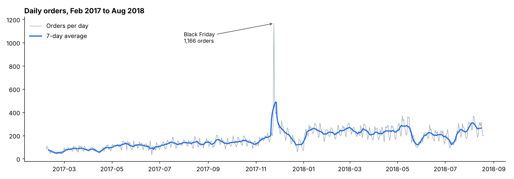
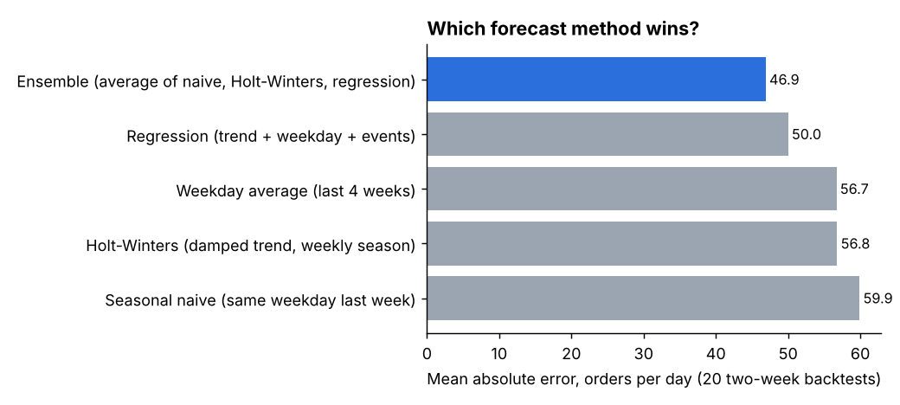
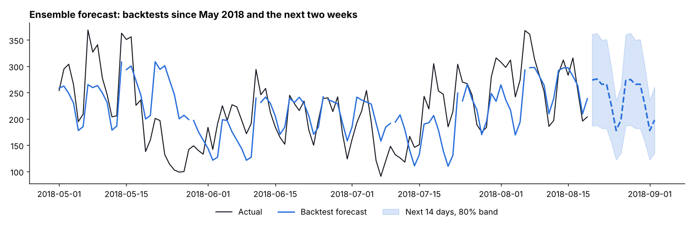

# Forecasting Daily Orders: Olist Marketplace Demand

How many orders will the marketplace get each day over the next two weeks? Operations teams use this kind of forecast to staff support, book carrier capacity and plan promotions. This project forecasts daily Olist orders 14 days ahead, tests five methods on **20 rolling two-week backtests**, and reports how wrong each one would have been.

**Tools:** Python (pandas, statsmodels: OLS, Holt-Winters exponential smoothing), rolling-origin backtesting, SQL (reads project 06's SQLite model)

## Key findings

1. **A simple average of three models wins.** Averaging seasonal naive, Holt-Winters and a regression gave a mean error of **46.9 orders a day**, **22% lower** than the seasonal-naive baseline (59.9). Its typical (median) two-week error is **17%**. No single model beat it.
2. **Weekly rhythm is strong and stable.** Holding the trend fixed, Saturdays get **32% fewer** orders than Mondays and Sundays **26% fewer**. Monday to Wednesday are nearly equal. Staff and carrier capacity should follow that shape.
3. **Black Friday is the hardest day to forecast, and one year of data can't teach it.** Black Friday 2017 brought **1,166 orders**, about 7.7 times what the regression expects for a Friday then (+674%). It's the only Black Friday in the data, so every model missed it in advance. The week after is where models differ: copying last week (seasonal naive) was off by **255 orders a day**, while the regression, which now knew the spike was a one-off event, was off by **102**.
4. **Shocks break every method.** The worst ordinary backtest starts May 13, 2018 (62% error). Orders fell from about 350 a day to about 100 in late May, which coincides with Brazil's nationwide truckers' strike. A forecast can't see that coming, so plans need a buffer: the ensemble's 80% band runs from **0.68x to 1.32x** the point forecast.

| | |
|---|---|
|  |  |



## Method

- **Series:** completed orders per day from project 06's `sales` view, trimmed to whole weeks from **Feb 6, 2017 to Aug 19, 2018** (560 days, 95,613 orders). Before February the marketplace was still ramping up (single-digit days). After August 19 the dataset's collection cutoff makes counts collapse from 252 to 11 in ten days, which would look like a demand crash.
- **Methods:**
  - *Seasonal naive:* the same weekday last week (the baseline to beat)
  - *Weekday average:* the mean of the same weekday over the last 4 weeks
  - *Holt-Winters:* damped additive trend and weekly seasonality on log orders, fit on the last 26 weeks
  - *Regression:* OLS on log orders with a trend, weekday dummies, and Black Friday and Christmas flags (known in advance), fit on the last 26 weeks
  - *Ensemble:* the plain average of seasonal naive, Holt-Winters and the regression
- **Backtest:** 20 forecast origins, 14 days apart, ending August 5, 2018. Each method sees only data up to its origin and forecasts the next 14 days. Metrics: mean absolute error (orders per day), mean absolute percentage error, and the error on the two-week total.
- **Uncertainty:** the 80% band comes from the 10th and 90th percentiles of actual-to-forecast ratios in the ensemble's own backtests.

| Method | MAE (orders/day) | MAPE | Median MAPE | Two-week total error |
|---|---|---|---|---|
| **Ensemble** | **46.9** | **22.4%** | **16.9%** | 15.7% |
| Regression | 50.0 | 23.1% | 22.7% | 15.9% |
| Weekday average | 56.7 | 28.5% | 18.9% | 19.4% |
| Holt-Winters | 56.8 | 26.2% | 20.4% | 21.5% |
| Seasonal naive | 59.9 | 28.5% | 18.8% | 17.5% |

## Run it

```bash
pip install pandas numpy matplotlib statsmodels
python ../06-olist-ecommerce-sql/build_db.py   # once: downloads the data and builds olist.db
python forecast.py                             # -> output/*.csv and output/chart_*.png
```

Outputs: `backtest_folds.csv` (every method on every fold), `backtest_predictions.csv`, `backtest_summary.csv`, `weekday_effect.csv`, `event_effect.csv`, and `forecast_next_14_days.csv`.

## Limitations

- **One year of seasonality.** With one Black Friday and one Christmas, yearly effects are estimated from a single example each. A second year would let the regression forecast Black Friday instead of only recognizing it afterwards.
- **No external drivers.** Marketing spend, prices and promotions aren't in the public data. They would likely explain much of the remaining error.
- **The truckers' strike link is a coincidence of timing**, not something the data proves.
- The "forecast" for Aug 20 to Sep 2, 2018 can't be checked, because the dataset ends there.
