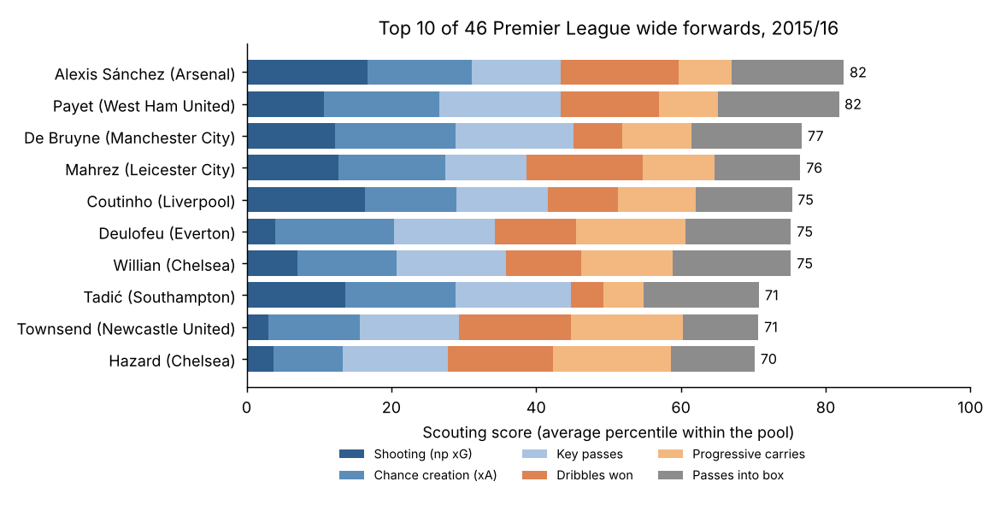
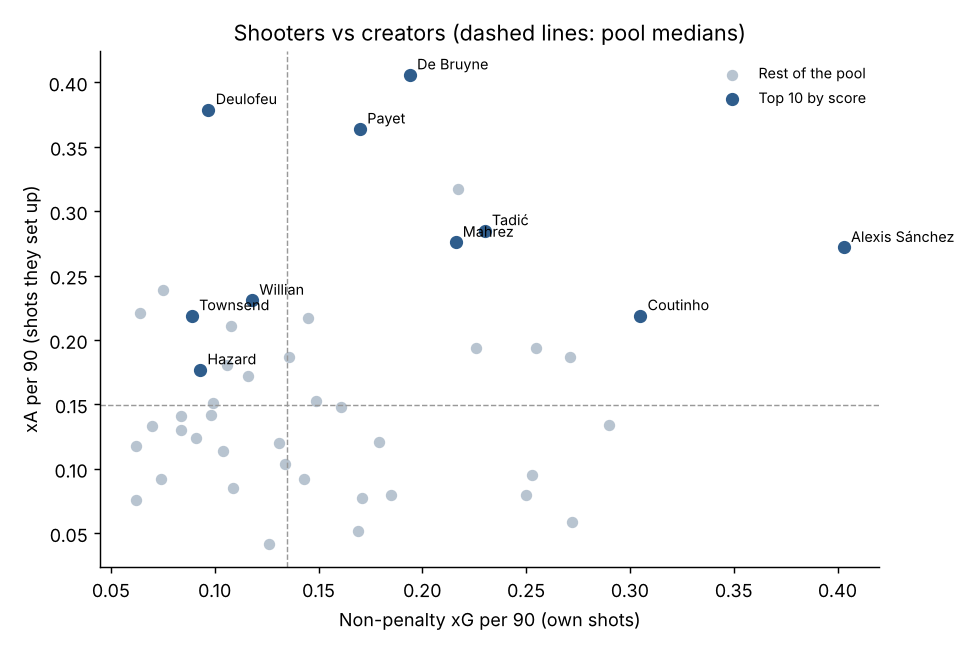
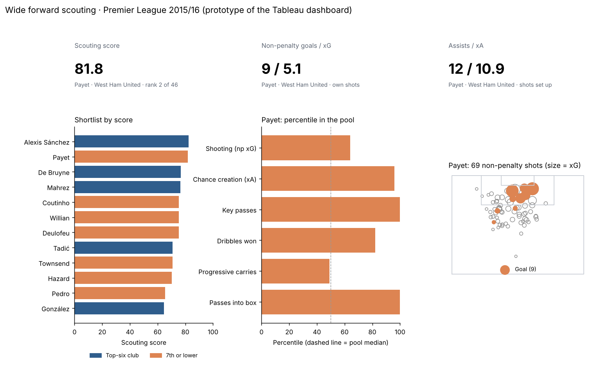

# Football Scouting in SQL: Premier League Wide Forwards, 2015/16

A mid-table club needs a winger. Which wide forwards created the most danger per 90 minutes, which of them play for clubs that might sell, and does the shortlist survive a change in what we value? This project loads every event of all 380 Premier League 2015/16 matches from StatsBomb Open Data into SQLite, computes per-90 metrics in SQL with a minutes threshold, and ranks the position with percentiles.

**Tools:** SQL (SQLite: CTEs, window functions `PERCENT_RANK` / `RANK` / `ROW_NUMBER`, self-joins, conditional aggregation, `UNION ALL` reshaping), Python (JSON flattening, pandas, matplotlib, SciPy Kendall's τ), Tableau Public (relationships, parameters, filter actions).

**Data:** [StatsBomb Open Data](https://github.com/statsbomb/open-data), used under StatsBomb's free non-commercial terms. Data source: **StatsBomb**.

## Key findings

1. **Alexis Sánchez and Dimitri Payet lead a pool of 46 wide forwards.** Sánchez (Arsenal, score **82.5**) had the pool's highest non-penalty xG at **0.40 per 90** and 13 non-penalty goals. Payet (West Ham, **81.8**) made the most key passes at **3.75 per 90**, and 12 assists. De Bruyne, Mahrez and Coutinho complete the top five.
2. **The realistic targets play outside the top six.** Of the top 10, six play for clubs that finished 7th or lower: **Payet** (West Ham, 7th), **Coutinho** (Liverpool, 8th), **Willian** and **Hazard** (Chelsea, 10th the season after winning the title), **Deulofeu** (Everton, 11th) and **Townsend** (Newcastle, 18th, relegated). Deulofeu's **0.38 xA per 90** was second only to De Bruyne's, from just 1,447 minutes, so he is the cheapest bet and the riskiest.
3. **Leicester's title winger finished well above his chances.** Riyad Mahrez scored **13 non-penalty goals from 7.5 xG** (+5.5), the biggest gap in the pool. Anthony Martial was +4.1 and Payet +3.9. A gap that size rarely repeats, so a buyer should pay for the 7.5, not the 13. At the other end, Moussa Sissoko scored 1 from 3.7.
4. **The shortlist holds up when the weights change.** Across 1,000 random re-weightings of the six metrics (each weight moved by up to ±30%), the full ranking kept a median **Kendall's τ of 0.955** (lowest 0.872), and the top 10 kept a median of **10 of 10** players (never fewer than 8). Seven players stayed in the top 10 every time: Alexis Sánchez, Payet, De Bruyne, Mahrez, Coutinho, Deulofeu and Willian.
5. **Shooters and creators are different players.** Coutinho and Sánchez sit far right on the chart below (high xG of their own), while Deulofeu, Payet and De Bruyne sit at the top (high xA). A club can pick the profile it lacks instead of the highest score.

| | |
|---|---|
|  |  |

**So what?** For a mid-table club, the shortlist is Payet, Coutinho and Willian if the budget is large, and Deulofeu or Townsend if it isn't. Both of those last two need a closer look at a full season's minutes before any fee. The next step would be adding age, contract length and price, which StatsBomb's event data doesn't include.

## Tableau dashboard

<!-- TODO: Nurs adds the Tableau Public link and a screenshot here once published -->
The Tableau Public version is built from the guide below. `prototype.py` draws its layout from the same extracts:



*Python prototype. It opens on the best-scoring player outside the top six (Payet). In Tableau, clicking any player in the shortlist updates the tiles, the profile and the shot map.*

`export_extracts.py` writes two tidy CSVs to `tableau/`. It checks that each player's shots add up to their non-penalty goals and xG in the analysis.

| File | Grain | Key fields |
|---|---|---|
| `tableau/players.csv` | one row per pool player (46) | `score_rank`, `player`, `team`, `club_finish`, `club_tier`, `minutes`, `score`, six per-90 metrics, six percentiles (`p_*`), `np_goals`, `assists`, `np_xg`, `xa` |
| `tableau/shots.csv` | one row per non-penalty shot (2,000) | `player_id`, `player`, `team`, `match_date`, `minute`, `x`, `y` (120 × 80 pitch), `xg`, `outcome`, `is_goal` |

**Build it in Tableau Public**

1. **Connect:** *Text file* → `tableau/players.csv`, then add `tableau/shots.csv` as a second source. Relate them on `player_id`.
2. **Calculated fields**
   - `Goals minus xG` = `SUM([np_goals]) - SUM([np_xg])`
   - `Pitch x (vertical)` = `[x]` and `Pitch y` = `[y]`. StatsBomb's `y` starts at the attacker's left touchline, so with x on Rows the goal is at the top and left stays left, as in the prototype
   - `Shot size` = `[xg]`
3. **Parameter:** *Club tier* (All / Top six / 7th or lower), with a calculated filter `[Club tier] = "All" OR [club_tier] = [Club tier]`.
4. **Sheets**
   - *Shortlist*: `player` on Rows sorted by `score`, `score` on Columns, colored by `club_tier`.
   - *KPI tiles*: one text sheet each for `score` (with `score_rank`), `np_goals` / `np_xg`, and `assists` / `xa`.
   - *Percentile profile*: the six `p_*` fields as bars (Measure Names on Rows), with a reference line at 50.
   - *Shot map*: `Pitch y` on Columns and `Pitch x (vertical)` on Rows (axis 60 to 120), circles sized by `Shot size` and colored by `is_goal`. Add a half-pitch image as the background (*Map → Background Images*, x 0 to 80, y 60 to 120).
5. **Dashboard:** 1200 × 800, tiles across the top and the three charts below, matching the prototype. Make the shortlist a **filter action** that drives the tiles, the profile and the shot map, and add the *Club tier* parameter control.
6. **Publish** to Tableau Public. Credit StatsBomb in the dashboard footer, then put the link and a screenshot at the top of this section and on the portfolio front page.

## Excel version

[`excel/scouting_shortlist.xlsx`](excel/) has the same 46 players as an Excel Table, a **PivotTable** by club tier and club, and an **XLOOKUP** player card with a drop-down list. See [`excel/README.md`](excel/README.md) for what each sheet shows.

## Data model

```
matches        (match_id PK, match_date, home_team, away_team, home_score, away_score)
events         (event_id PK, match_id FK, period, minute, type, team, player_id, player,
                x, y, end_x, end_y, outcome, xg, shot_type, key_pass_id → events.event_id,
                shot_assist, goal_assist, is_cross)
spells         (match_id FK, team, player_id, player, position, start_min, end_min)
player_minutes (player_id, team, minutes, wide_minutes, matches)
VIEW player_actions      = season totals per player: np xG, shots, key passes, dribbles,
                           progressive carries, passes into the box, high recoveries
VIEW player_xa           = xG of every shot a player's pass set up (self-join on key_pass_id)
VIEW wide_forwards       = the pool (900+ minutes on the wing, 60%+ of their minutes) per 90
VIEW wide_forward_scores = each metric as a percentile in the pool, and their average (score)
```

`build_db.py` downloads the match, lineup and event JSON (cached in `data/`) and flattens it into all-text staging tables. `sql/00_schema.sql` does the typing, turns lineup clock strings into minutes, and builds the views. Each question has its own file:

| File | Question | SQL techniques |
|---|---|---|
| `01_data_quality.sql` | Is the data complete, and do minutes and goals add up? | `UNION ALL` checks, anti-join |
| `02_league_table.sql` | The final table, from the 380 results | `UNION ALL` home/away, `RANK()`, conditional sums |
| `03_wide_forward_shortlist.sql` | Top 10 wide forwards by score | per-90 view, `PERCENT_RANK()`, `RANK()` |
| `04_outside_top_six.sql` | The best wide forwards at clubs that finished 7th or lower | CTE league position, join, filter |
| `05_finishing_vs_xg.sql` | Who scored more or fewer goals than their chances were worth? | derived difference, ordering |
| `06_profiles.sql` | Each top-10 player's strongest metric | `UNION ALL` unpivot, `ROW_NUMBER()` per player |

## Method

- **Position:** wide forwards are players with **900+ minutes** at Right Wing, Left Wing, Right Midfield or Left Midfield who spent **at least 60%** of their minutes there (46 players).
- **Minutes:** from lineup spells. A spell with no end ran to the final whistle, the last event of that match. Checked: about 1,038 player-minutes per team per match (11 players × about 94 minutes).
- **Metrics per 90:** non-penalty xG; xA (xG of the shots their passes set up); key passes; dribbles won; progressive carries (10+ yards toward goal, ending in the opponent's half); completed passes into the penalty area from outside it.
- **Score:** the average of the six percentiles within the pool. `run_analysis.py` re-weights them 1,000 times to test the ranking.
- **Checks:** 380 matches and 719,060 events kept. 988 goals came from shots and the season had 1,026, a gap that matches own goals. Every shot's key pass was found.

## Run it

```bash
pip install -r ../requirements.txt
python build_db.py      # downloads ~1.1 GB of JSON on first run (cached in data/), builds output/scouting.db
python run_analysis.py  # writes the CSVs, results.json and both charts to output/
python export_extracts.py  # -> tableau/players.csv, tableau/shots.csv
python prototype.py        # -> output/prototype.png
python build_excel.py      # -> excel/scouting_shortlist.xlsx (needs LibreOffice for the PivotTable)
```

## Limitations

- **One season, nine years old.** StatsBomb's free Premier League data covers only 2015/16, so this shows the method, not a current transfer list.
- **Per-90 uses all of a player's minutes.** Events aren't tagged with the position held at the time, so a winger's few games at full-back count too. The 60% rule keeps this small.
- **Attacking output only.** The score has no defensive work. High recoveries are computed in `wide_forwards` but left out of the score.
- **Per team, not per player.** Andros Townsend moved from Tottenham to Newcastle in January, and only his 1,128 Newcastle minutes made the pool.
- **xG and xA are StatsBomb's model**, and a short season of xG still carries noise.
- **No age, contract or fee data**, which a real shortlist would need.
