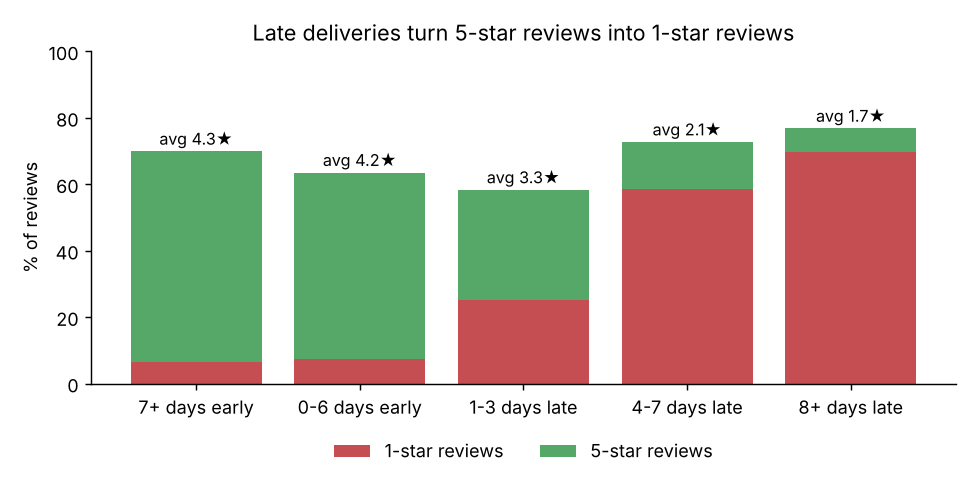
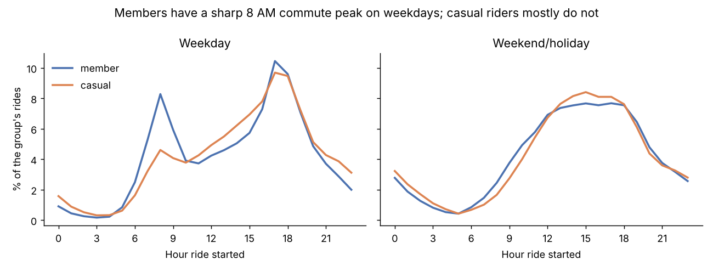
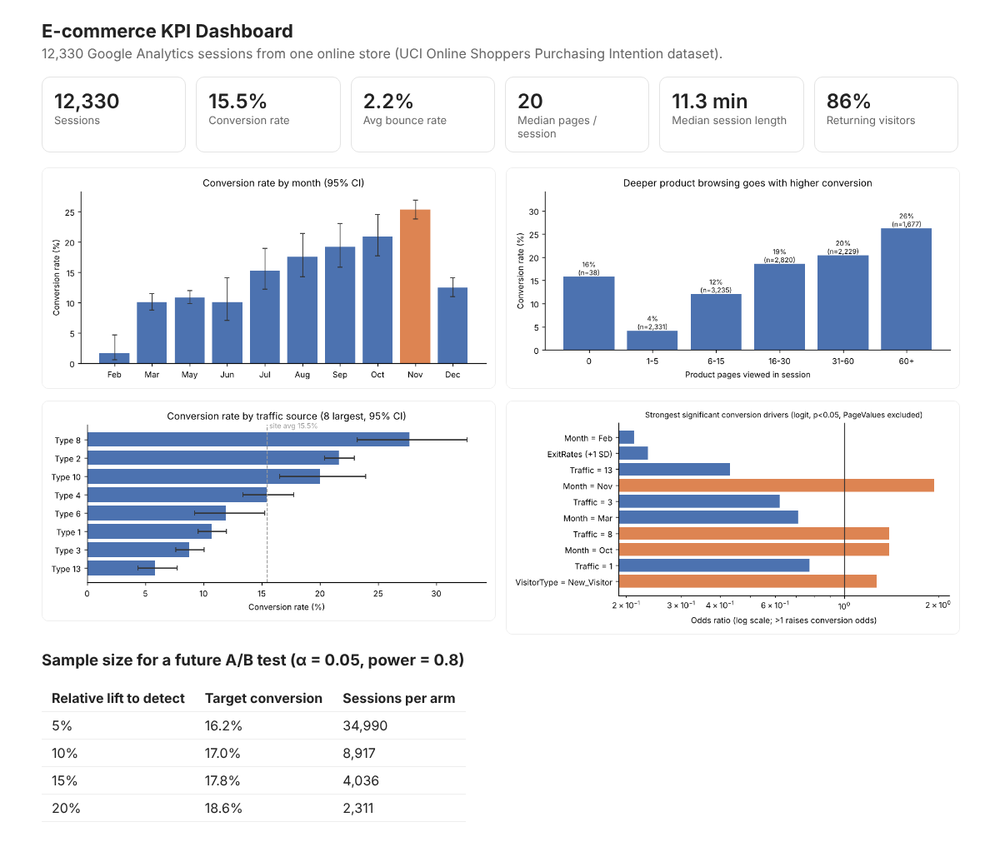
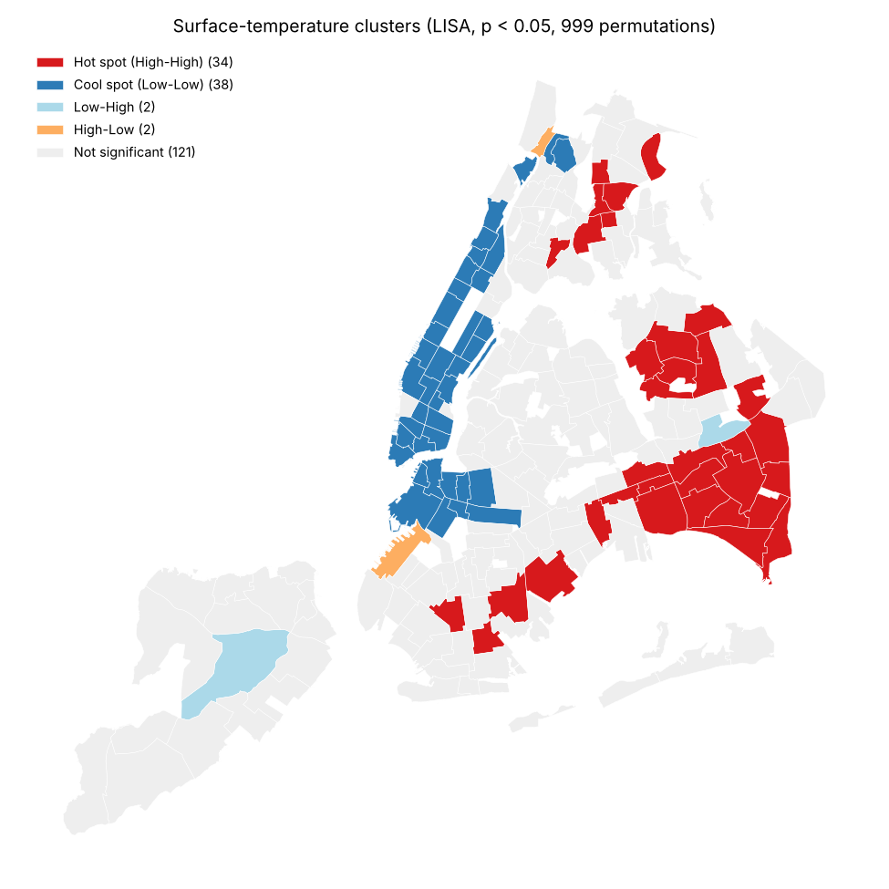
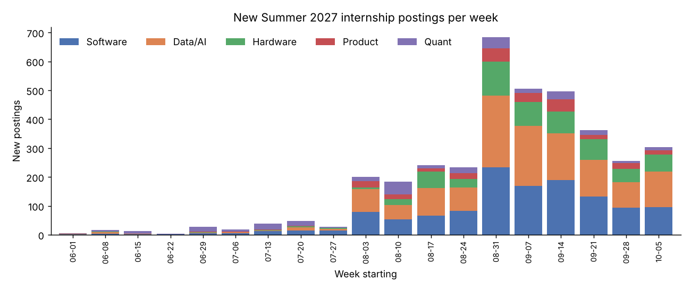

# Nursultan Nurgali · Data Analytics Portfolio

[](https://github.com/nurgalinursultan14-afk/data-analytics-portfolio/actions/workflows/ci.yml)

I turn messy public data into clear answers for the people who make decisions: SQL first, Python for statistics and maps, and a chart for every claim. I'm looking for **Summer 2027 data analyst / business analyst internships, ideally in New York.**

🌐 **Portfolio site:** [nurgalinursultan14-afk.github.io/data-analytics-portfolio](https://nurgalinursultan14-afk.github.io/data-analytics-portfolio/) · 📊 **[Live dashboard](https://nurgalinursultan14-afk.github.io/data-analytics-portfolio/olist-dashboard.html)**

**Contact:** [GitHub](https://github.com/nurgalinursultan14-afk) · <!-- TODO: add LinkedIn URL --> LinkedIn · <!-- TODO: add email --> Email · <!-- TODO: add resume link --> Resume

**Toolkit:** SQL (CTEs, window functions, star schemas, cohort and RFM analysis) · Python (pandas, statsmodels, scikit-learn, GeoPandas) · statistics (hypothesis tests, regression, power analysis, spatial autocorrelation) · Tableau · dbt · web scraping · pytest · git

---

## Projects at a glance

| # | Project | Headline result | Skills |
|---|---|---|---|
| 08 | [**Olist Marketplace, in dbt**](08-olist-dbt/) | Rebuilt project 06 as a production-style dbt pipeline with **46 automated data tests**. Retention and GMV are reproduced exactly. | dbt (staging/marts, generic and singular tests, lineage), DuckDB, BigQuery-ready |
| 07 | [**Olist Marketplace Dashboard, in Tableau**](07-olist-tableau-dashboard/) | One screen for sales, late deliveries by state and their effect on reviews (1.7 stars when 8+ days late vs. 4.3 when early). **[Open the live dashboard](https://nurgalinursultan14-afk.github.io/data-analytics-portfolio/olist-dashboard.html)** | Tableau (LOD, parameters, dashboard actions), SQL extracts |
| 06 | [**E-commerce Customer Retention, in SQL**](06-olist-ecommerce-sql/) | Only **2.2%** of 94,703 customers ever came back, and orders 8+ days late drew **1-star reviews 70%** of the time. | 7-table SQL model, cohort retention, RFM with `NTILE`, Pareto |
| 05 | [**NYC Citi Bike, in SQL**](05-citibike-sql/) | Across 5 million rides, a storm weekend cut member rides by **62 to 72%**, and office stations gain up to **135 bikes** every weekday morning. | Star schema, SQL data cleaning, `LAG`, `RANK`, weather joins |
| 03 | [**E-commerce Web Analytics**](03-web-analytics-kpi/) | November converts at **25.4%** vs. ~10% in spring, and a 10% lift test needs **8,917 sessions per arm**. Caught a leaking feature that inflated AUC from 0.75 to 0.91. | KPI dashboard, z / χ² tests, logistic regression, power analysis |
| 02 | [**NYC Heat Vulnerability GIS**](02-nyc-heat-vulnerability-gis/) | Greenspace cools neighborhoods by **0.92°F per 10 points** once spatial effects are modeled, and risk clusters in the Bronx and southeast Queens. | GeoPandas, Moran's I / LISA, spatial regression |
| 01 | [**The Summer 2027 Internship Market, in SQL**](01-internship-market-sql/) | **1 in 4** postings closed within two weeks, and **46%** of the season's postings landed in three September weeks. | SQLite, CTEs, window functions, git-history mining |
| 04 | [**Internship Scraper and Fit Ranker**](04-internship-scraper-ranker/) | Ranked 1,560 live postings for one candidate. The ranking held up under ±30% weight changes (Kendall's τ = 0.95). | requests, BeautifulSoup, weighted scoring, sensitivity analysis, pytest |

---

## Highlights

<table>
<tr>
<td width="50%" valign="top">
<a href="06-olist-ecommerce-sql/"></a>
<br><b><a href="06-olist-ecommerce-sql/">06 · Customer retention</a></b><br>
Late delivery is the main driver of bad reviews, and a late first order means fewer customers come back (2.0% vs. 2.9%).
</td>
<td width="50%" valign="top">
<a href="05-citibike-sql/"></a>
<br><b><a href="05-citibike-sql/">05 · Citi Bike</a></b><br>
Members commute (19.5% of weekday rides start 7 to 10 AM), while casual riders circle Central Park and DUMBO.
</td>
</tr>
<tr>
<td width="50%" valign="top">
<a href="03-web-analytics-kpi/"></a>
<br><b><a href="03-web-analytics-kpi/">03 · Web analytics</a></b><br>
A KPI dashboard, segment tests with confidence intervals, a conversion model and an A/B test sizing.
</td>
<td width="50%" valign="top">
<a href="02-nyc-heat-vulnerability-gis/"></a>
<br><b><a href="02-nyc-heat-vulnerability-gis/">02 · NYC heat GIS</a></b><br>
34 significant surface-temperature hot spots, 22 of them in southeast and central Queens.
</td>
</tr>
<tr>
<td width="50%" valign="top">
<a href="01-internship-market-sql/"></a>
<br><b><a href="01-internship-market-sql/">01 · Internship market</a></b><br>
Postings peak in early September, and Workday hosts 48% of them.
</td>
<td width="50%" valign="top">
<b><a href="04-internship-scraper-ranker/">04 · Scraper and ranker</a></b><br>
Scrapes the SimplifyJobs list, parses its quirks into clean fields and ranks every posting with a transparent score. Writing the tests caught a real bug: "London, UK" was being scored as a US city.
</td>
</tr>
</table>

---

## How the projects are built

- **Real public data**, not toy datasets. Every source is listed below.
- **Reproducible.** Every chart and number in the READMEs is regenerated by the scripts in that folder.
- **Honest about limits.** Each project README ends with what the data can't tell you.

## Run it yourself

```bash
python -m venv .venv && source .venv/bin/activate
pip install -r requirements.txt
```

Then follow the "Run it" section in each project's README.

## Data sources

All data is public: SimplifyJobs Summer2027-Internships (GitHub), NYC DOHMH Environment & Health Data Portal (Apache-2.0), the UCI Online Shoppers Purchasing Intention dataset (CC BY 4.0), Citi Bike System Data (Citi Bike Data License), NOAA GHCN-Daily weather and the Olist Brazilian e-commerce dataset (MIT).
